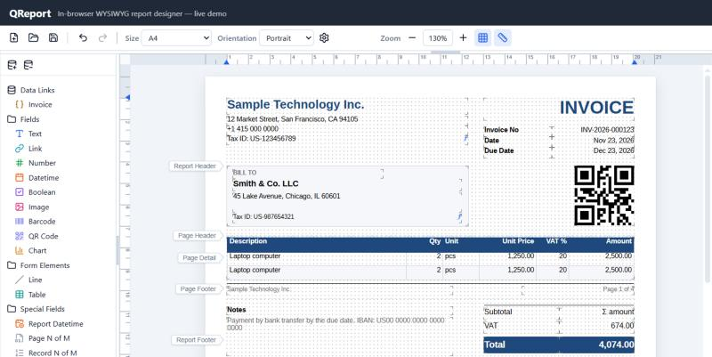
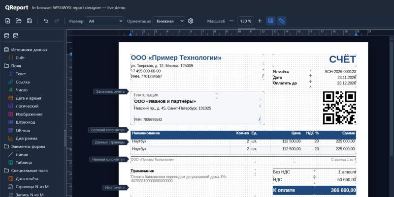
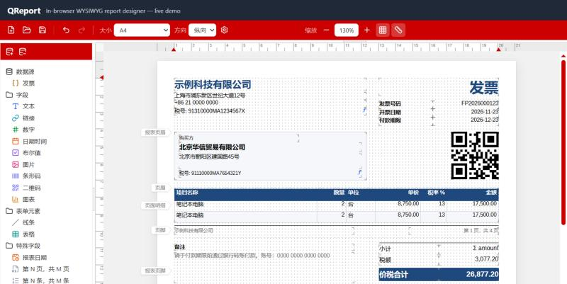

# QReport — Live Demo

**QReport** is an embeddable, in-browser WYSIWYG **report designer**. Users place fields in banded
sections, bind them to JSON/XML data, and the engine renders the report to **PDF (and Excel) in the
browser** with pdfmake — no server needed. The same engine **also runs on the server** (Node:
`renderPdf(report, data)` returns a PDF Buffer) for e-mail, scheduled or batch reports.

## ▶ Live demo

**https://murmor1.github.io/qreport-demo/**

- Drag fields from the left onto the page, or start from a template with **New**.
- Click **Preview** for a PDF, or **Download Excel**.
- **Change the language and theme** from the **Preferences** button (right end of the toolbar):
  24 interface languages and several themes — light / dark, Windows 10 / 11, Bootstrap and the
  classic jQuery UI themes.

<p align="center">
  <a href="screenshots/en.jpg"></a>
  <a href="screenshots/ru.jpg"></a>
  <a href="screenshots/zh.jpg"></a>
</p>
<p align="center"><sub>English (light) · Русский (dark) · 简体中文 (Blitzer) — each in its own invoice template; click to enlarge</sub></p>

## Highlights

- **AI-assisted design** via WebMCP / MCP — an AI agent can build the report for you.
- **Client-side PDF & Excel** — no server round-trip; **server-side** rendering is available too.
- **24 UI languages, rendered in the PDF as well** — Latin, Chinese (Simplified & Traditional),
  Japanese, Korean and Hindi, using bundled Noto fonts (SIL Open Font License 1.1).
- Ready-made templates, many themes, barcodes, charts, grouping, conditional formatting.
- Embeddable as a plain library, a **Web Component** (`<qreport-designer>`), or a **React / Vue**
  wrapper; **SSR-ready** (Next.js, Nuxt).

## Embed it

A full designer in a few lines:

```html
<link rel="stylesheet" href="qreport/qreport.css">
<script src="qreport/qreport.min.js"></script>

<div id="designer" style="height: 100vh"></div>
<script>
  new QReport(document.getElementById('designer'), { language: 'english' });
</script>
```

## Developer-controlled toolbar

The whole toolbar is yours — hide buttons, reorder groups, or collapse items into menus.
Hide what you do not need:

```js
new QReport(el, { toolbar: { file: false, excel: false } });
```

…or define the full layout:

```js
new QReport(el, {
  language: 'english',
  theme: 'modern',
  toolbar: {
    groups: [
      { name: 'file',   items: ['new', 'open', 'save'] },
      { name: 'edit',   items: ['undo', 'redo'] },
      { name: 'report', items: ['pagesize', 'orientation', 'zoom'] },
      { name: 'output', items: ['preview', 'pdf', 'excel', 'print'] },
      { name: 'prefs',  type: 'menu', align: 'right', items: ['theme', 'language'] }
    ]
  }
});
```

## Examples & integrations (included with the product)

**Embedding / front-end**

- Plain JavaScript library
- Web Component — `<qreport-designer>`
- React wrapper
- Vue wrapper
- Server-side rendering (SSR) — Next.js, Nuxt

**Server-side** (store reports, data API, server-side PDF — the same REST API in each)

- Node.js (dependency-free)
- ASP.NET Core (C#)
- Django (Python)
- Spring Boot (Java)
- Laravel (PHP)

Also: AI panel proxy, WebMCP and MCP-bridge examples for AI-assisted design.

## Languages

All 24 interface languages are also available when rendering the PDF:

English, Türkçe (Turkish), Deutsch (German), Français (French), Nederlands (Dutch),
Español (Spanish), Italiano (Italian), Português (Portuguese), Svenska (Swedish), Polski (Polish),
Čeština (Czech), Română (Romanian), Ελληνικά (Greek), Català (Catalan), Magyar (Hungarian),
Русский (Russian), 简体中文 (Chinese, Simplified), 繁體中文 (Chinese, Traditional), 日本語 (Japanese),
한국어 (Korean), Українська (Ukrainian), Tiếng Việt (Vietnamese), हिन्दी (Hindi),
Bahasa Indonesia (Indonesian).

## Trial notice

This repository hosts the **trial build** only:

- every PDF / Excel carries a **demo watermark**;
- **Save** and **Open** (report files) are disabled;
- everything else works — designing, templates, language & theme switching, preview,
  PDF / Excel download, printing.

The source code is **not** included here; only the compiled demo is published.
QReport is a commercial product — contact the author for licensing.

---

## Türkçe

**QReport**, başka web uygulamalarına gömülebilen, tarayıcıda çalışan WYSIWYG bir **rapor
tasarımcısıdır**. Kullanıcı alanları bantlı bölümlere yerleştirir, JSON/XML verisine bağlar; motor
raporu **tarayıcıda** pdfmake ile PDF'e (ve Excel'e) çevirir — sunucu gerekmez. Aynı motor **sunucuda
da çalışır** (Node: `renderPdf(rapor, veri)` bir PDF Buffer döndürür): e-posta, zamanlanmış ya da
toplu raporlar için.

### ▶ Canlı demo

**https://murmor1.github.io/qreport-demo/**

- Alanları soldan sayfaya sürükleyin ya da **New** ile bir şablondan başlayın.
- **Preview** ile PDF alın, ya da **Download Excel**.
- **Dil ve temayı** araç çubuğunun sağındaki **Preferences** düğmesinden değiştirin: 24 arayüz dili
  ve çeşitli temalar — açık / koyu, Windows 10 / 11, Bootstrap ve klasik jQuery UI temaları.

### Öne çıkanlar

- **Yapay zekâ ile tasarım** (WebMCP / MCP) — raporu bir yapay zekâ ajanı kurabilir.
- **İstemci tarafı PDF & Excel** — sunucuya gidiş yok; **sunucu tarafı** üretim de mümkün.
- **24 arayüz dili PDF'te de** — Latin, Çince (Basit & Geleneksel), Japonca, Korece ve Hintçe;
  gömülü Noto fontlarıyla (SIL Open Font License 1.1).
- Hazır şablonlar, çok sayıda tema, barkod, grafik, gruplama, koşullu biçimlendirme.
- Kütüphane, **Web Component** (`<qreport-designer>`) ya da **React / Vue** sarmalayıcı olarak
  gömülebilir; **SSR** hazır (Next.js, Nuxt).

### Gömme

Birkaç satırda tam bir tasarımcı:

```html
<link rel="stylesheet" href="qreport/qreport.css">
<script src="qreport/qreport.min.js"></script>

<div id="designer" style="height: 100vh"></div>
<script>
  new QReport(document.getElementById('designer'), { language: 'english' });
</script>
```

### Araç çubuğu tamamen sizin kontrolünüzde

Düğmeleri gizleyin, grupları yeniden sıralayın ya da menüye toplayın. İstemediğinizi gizleyin:

```js
new QReport(el, { toolbar: { file: false, excel: false } });
```

…ya da düzeni baştan tanımlayın:

```js
new QReport(el, {
  language: 'english',
  theme: 'modern',
  toolbar: {
    groups: [
      { name: 'file',   items: ['new', 'open', 'save'] },
      { name: 'edit',   items: ['undo', 'redo'] },
      { name: 'report', items: ['pagesize', 'orientation', 'zoom'] },
      { name: 'output', items: ['preview', 'pdf', 'excel', 'print'] },
      { name: 'prefs',  type: 'menu', align: 'right', items: ['theme', 'language'] }
    ]
  }
});
```

### Örnekler ve entegrasyonlar (ürünle birlikte gelir)

**Gömme / ön yüz**

- Düz JavaScript kütüphanesi
- Web Component — `<qreport-designer>`
- React sarmalayıcı
- Vue sarmalayıcı
- Sunucu tarafı oluşturma (SSR) — Next.js, Nuxt

**Sunucu tarafı** (rapor saklama, veri API'si, sunucuda PDF — hepsinde aynı REST API)

- Node.js (bağımlılıksız)
- ASP.NET Core (C#)
- Django (Python)
- Spring Boot (Java)
- Laravel (PHP)

Ayrıca: yapay zekâ paneli ara adresi, WebMCP ve MCP köprüsü örnekleri.

### Diller

24 arayüz dilinin tamamı PDF üretiminde de kullanılabilir:

English, Türkçe, Deutsch (Almanca), Français (Fransızca), Nederlands (Felemenkçe),
Español (İspanyolca), Italiano (İtalyanca), Português (Portekizce), Svenska (İsveççe),
Polski (Lehçe), Čeština (Çekçe), Română (Rumence), Ελληνικά (Yunanca), Català (Katalanca),
Magyar (Macarca), Русский (Rusça), 简体中文 (Çince, Basitleştirilmiş), 繁體中文 (Çince, Geleneksel),
日本語 (Japonca), 한국어 (Korece), Українська (Ukraynaca), Tiếng Việt (Vietnamca), हिन्दी (Hintçe),
Bahasa Indonesia (Endonezce).

### Deneme sürümü notu

Bu depo yalnızca **deneme (trial) derlemesini** barındırır:

- her PDF / Excel'de **demo filigranı** bulunur;
- **Kaydet** ve **Aç** (rapor dosyası) kapalıdır;
- tasarım, şablonlar, dil & tema değiştirme, önizleme, PDF / Excel indirme ve yazdırma çalışır.

Kaynak kod bu depoda **yoktur**; yalnızca derlenmiş demo yayımlanır.
QReport ticari bir üründür — lisans için geliştiriciyle iletişime geçin.
